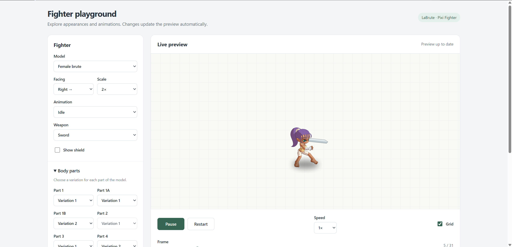

# LaBrute Pixi Fighter



PixiJS fighter animations and FLA symbol data for LaBrute. Previously published
as `labrute-fla-parser`.

## Installation
```
npm i labrute-pixi-fighter
```

The Pixi fighter renderer requires `pixi.js@^8.19.0` as a peer dependency. Pixi
is supplied by the application so the renderer shares its ticker, assets, and
scene objects with production.

## Usage

```ts
import { Symbol475 } from 'labrute-pixi-fighter';

console.log(Symbol475);
```

CommonJS consumers use the same named API:

```js
const { FighterHolder, Symbol475 } = require('labrute-pixi-fighter');
```

The package root selects a genuine ESM renderer for `import` and a CommonJS
renderer for `require`. Both are compiled from the same FighterHolder source.
The ESM renderer imports `pixi.js` directly, so Vite and other ESM applications
share their Pixi `Container` class and `Assets` cache with the fighter. CommonJS
applications share their own CommonJS Pixi runtime. Keep your application's Pixi
imports in the same module format as the renderer it loads.

The symbol/SVG object graph is published once in `dist/symbol-data.cjs`, without
Pixi or rendering dependencies. Both entry points reference this file; the ESM
entry does not wrap the CommonJS renderer. A browser bundler must support
CommonJS dependencies (as Vite and Webpack do). Symbol data is shared even when
both entry points are loaded in Node, while renderer classes and their private
texture caches are separate for each format. The shared data module limits
per-symbol tree shaking; selecting one symbol can still include the dataset.

`main` remains `dist/Symbols.js` for legacy CommonJS consumers, and `module` now
points to `dist/Symbols.mjs`. The existing `labrute-pixi-fighter/dist/Symbols.js`
path remains available for compatibility. Prefer the package root so conditional
exports select the appropriate renderer. Other internal paths are not public.
TypeScript Node16/NodeNext resolution selects `.d.cts` or `.d.mts` declarations;
legacy resolution uses `types` and `dist/Symbols.d.ts`. The package itself keeps
its existing CommonJS `.js` convention.

## Fighter animations

`FighterHolder` owns the Pixi animation timelines, SVG textures, sprite pools,
masks, equipment, shadows, animation events, and playback snapshots.

```ts
import { FighterHolder } from 'labrute-pixi-fighter';

// app is an initialized Pixi 8 Application. Appearance decoders belong to your app.
const holder = new FighterHolder(app, {
  type: 'brute',
  name: fighter.name,
  model: fighter.gender ?? 'male',
  team: fighter.team,
  shield: fighter.shield,
  parts: readBodyString(fighter.body),
  colors: readColorString(fighter.gender ?? 'male', fighter.colors),
  width: 50,
  height: 80,
}, { current: 1 }, 2);

app.stage.addChild(holder.container);
await holder.ready;
holder.weapon = 'sword';
holder.setAnimation('idle');
holder.on('fist:hit', () => { /* synchronize fight effects */ });

// When removing the fighter:
holder.destroy();
```

`parts` uses decoded keys such as `p1` and `p1a`; `colors` uses `col0`, `col1`,
etc. Both maps are copied on construction. `width` and `height` are logical,
unscaled dimensions. The fourth constructor argument scales the model and its
dimensions. Models are `male`, `female`, `dog`, and `bear`; panthers use `dog`
with caller-supplied scaling and color offsets.

Keep the speed ref to change playback speed without recreating the holder.
`animationSpeed` also supports negative playback and accounts for model scale.
`setAnimation(animation, frame, true)` and `setAirborn(value, true)` update
`seekPose` without rendering. `capturePlaybackFrame()` and
`renderPlaybackFrame(snapshot)` preserve the production replay API; equipment
is maintained separately through `weapon` and `shield`.

Set `idleAnimation` to `monk` when appropriate, or override `setAnimation` in a
subclass to derive it from current skills. Supply Pixi `filters` for boss/pet
styling, and `colorOffset: { r, g, b }` to replace timeline color offsets.
Renderer internals stay private; the existing public controls and containers
remain available to subclasses and callers.

## Development

`npm run build` regenerates the published JavaScript and declarations.
Rollup builds the data module separately and marks it external in both renderer
builds, preventing two embedded copies. Named symbol exports are generated from
`src/symbols/index.ts`; add new exports there rather than editing build output.
Pixi remains an external peer dependency and is installed as a development
dependency for local checks.

After building, `npm run test:unit` runs the existing behavior suite against both
formats with real Pixi scene objects and filters, substituting SVG rasterization
and GPU probing in Node. It also checks public export parity, object identity,
consumer Pixi classes/cache, TypeScript NodeNext entry resolution, the packed
file list, and a browser bundle's module graph. The browser bundle must contain
only Pixi's ESM implementation. `npm run test:packaging` runs just the packaging
checks. `npm pack --dry-run` inspects the publishable artifact without publishing.

`npm run test:browser` additionally launches an installed Chromium browser
(or the executable in `BROWSER_BIN`) using headless WebGL with SwiftShader. It
constructs and renders male, female, dog, and bear fighters with real SVG assets,
checks colored output pixels, shadow texture generation, consumer Pixi identity,
and texture/cache reuse. Temporary bundle and result files live under the ignored
`.packaging-test` directory. This smoke check does not replace visual review of
animation frames in the playground. Restricted environments that cannot start
Chromium's sandbox can explicitly set `BROWSER_NO_SANDBOX=1` for this local test.

Run `npm install` after pulling dependency changes, then `npm test` and open
http://localhost:3000. The playground uses the exported renderer and refreshes
automatically when you change the model, facing, scale, body parts, or colors.
Animation and equipment selectors, playback speed, pause/restart buttons, and a
frame slider make it possible to inspect individual poses. Brutes also support
production body/color strings under **Import appearance**. `window.fighter`
exposes the current holder in the browser console.

The playground code is split into `PlaygroundControls.ts` (form state and DOM),
`PlaygroundPreview.ts` (Pixi lifecycle and rendering), `playgroundState.ts`
(appearance defaults), and `previewData.ts` (available choices). `index.ts` only
boots the page and connects those pieces.

At normal speed the preview renders at most 30 times per second, and stops
rendering when paused, hidden, offscreen, scrolling, or focused on a color picker.
Live color edits reuse the current fighter through `setColors()`;
model/body/scale changes recreate it.
